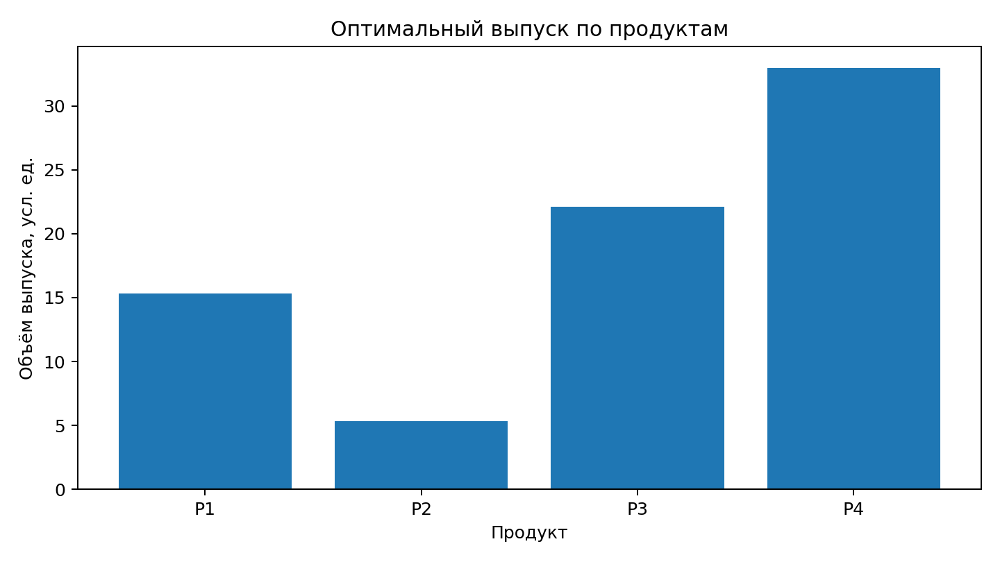
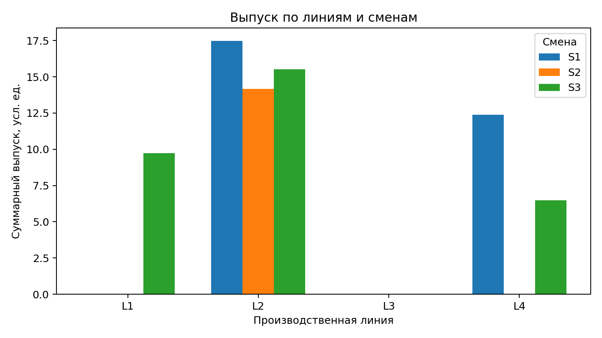
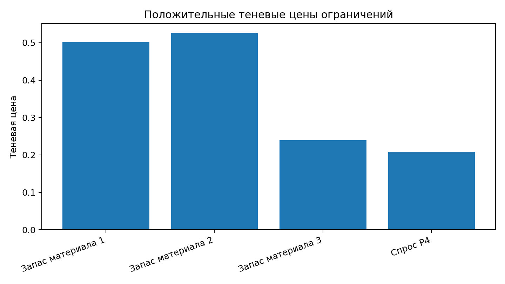

# Лабораторная работа № 1
## ЛП-модель распределения ресурсов

**Студент:** Казачкова Валерия Александровна  
**Группа:** Б24-507  
**Индивидуальный вариант:** 8  
**Seed:** 10013

## 1. Цель и индивидуальный вариант

Цель работы — построить непрерывную линейную модель распределения ресурсов, решить её солвером HiGHS, независимо проверить допустимость и значение целевой функции, провести сценарный анализ и интерпретировать результат.

Для группы Б24-507: \(N=13\), \(Q=0\), \(Y=26\). Номер варианта:

\[
V=1+((17N+7Q+Y)\bmod 20)=1+((17\cdot13+7\cdot0+26)\bmod20)=8.
\]

Seed:

\[
seed=10000+100Q+N=10000+13=10013.
\]

Вариант 8 — загрузка **4 производственных линий в 3 смены** для выпуска **4 продуктов**; критерий — максимум суммарного выпуска.

## 2. Формальная математическая модель

**Индексы и множества:**
- \(i\in I=\{1,2,3,4\}\) — производственная линия;
- \(s\in S=\{1,2,3\}\) — смена;
- \(p\in P=\{1,2,3,4\}\) — продукт;
- \(m\in M=\{1,2,3\}\) — вид материала.

**Переменная решения:** \(x_{isp}\ge0\) — объём продукта \(p\), выпускаемый на линии \(i\) в смену \(s\), условные единицы продукции.

**Параметры:**
- \(t_{ip}\) — время обработки единицы продукта \(p\) на линии \(i\), ч/условную единицу;
- \(H_{is}\) — доступное время линии \(i\) в смену \(s\), ч;
- \(a_{mp}\) — расход материала \(m\) на единицу продукта \(p\), условные единицы материала/условную единицу продукции;
- \(R_m\) — запас материала \(m\), условные единицы материала;
- \(D_p\) — верхняя граница спроса на продукт \(p\), условные единицы продукции;
- \(q_p=1\) — коэффициент вклада единицы каждого продукта в суммарный выпуск.

**Целевая функция:**

\[
\max Z=\sum_{i\in I}\sum_{s\in S}\sum_{p\in P}q_p x_{isp}.
\]

**Ограничения времени линий:**

\[
\sum_{p\in P}t_{ip}x_{isp}\le H_{is},\quad i\in I,\ s\in S.
\]

**Ограничения запасов материалов:**

\[
\sum_{i\in I}\sum_{s\in S}\sum_{p\in P}a_{mp}x_{isp}\le R_m,\quad m\in M.
\]

**Ограничения спроса:**

\[
\sum_{i\in I}\sum_{s\in S}x_{isp}\le D_p,\quad p\in P.
\]

**Неотрицательность:**

\[
x_{isp}\ge0,\quad i\in I,\ s\in S,\ p\in P.
\]

Все ограничения линейны, переменные непрерывные. В целевой функции единица любого продукта учитывается одинаково; это учебное допущение, поскольку продукты измеряются в общих условных единицах выпуска.

## 3. Исходные данные и их генерация

Методичка задаёт индивидуальный вариант, минимальный масштаб и seed, но не содержит фиксированной таблицы параметров или обязательных распределений генератора. Поэтому ниже приведена **принятая в работе процедура синтетической генерации**, а не значения, непосредственно выданные преподавателем.

Используется `numpy.random.default_rng(10013)`:

| Параметр | Процедура генерации | Размер |
|---|---|---:|
| Время обработки \(t_{ip}\) | равномерно на [0.38; 0.78] ч/ед. | 4×4 |
| Доступное время \(H_{is}\) | равномерно на [6.5; 8.0] ч | 4×3 |
| Спрос \(D_p\) | целые значения от 25 до 38 | 4 |
| Расход материала \(a_{mp}\) | равномерно на [0.45; 1.25] | 3×4 |
| Запас материала \(R_m\) | 62% от расхода на полный сгенерированный спрос | 3 |
| Коэффициент цели \(q_p\) | 1 для каждого продукта | 4 |

Спрос: P1 = 28, P2 = 26, P3 = 31, P4 = 33.  
Запасы: M1 = 60.837663, M2 = 51.086770, M3 = 48.267641.

Время обработки, ч/условную единицу:

| Линия | P1 | P2 | P3 | P4 |
|---|---:|---:|---:|---:|
| L1 | 0.5575 | 0.6072 | 0.6459 | 0.5766 |
| L2 | 0.5271 | 0.6117 | 0.4324 | 0.4489 |
| L3 | 0.6880 | 0.4188 | 0.3968 | 0.5946 |
| L4 | 0.7794 | 0.5886 | 0.5638 | 0.7235 |

Доступное время, ч:

| Линия | S1 | S2 | S3 |
|---|---:|---:|---:|
| L1 | 7.4365 | 7.7883 | 7.5549 |
| L2 | 7.8513 | 7.4704 | 7.7342 |
| L3 | 7.9978 | 7.1202 | 7.2296 |
| L4 | 6.9838 | 7.6018 | 6.8782 |

Расход материалов на единицу продукта:

| Материал | P1 | P2 | P3 | P4 |
|---|---:|---:|---:|---:|
| M1 | 0.8580 | 0.9561 | 0.7485 | 0.7890 |
| M2 | 0.5549 | 0.7689 | 0.9443 | 0.5333 |
| M3 | 1.1624 | 0.4866 | 0.5374 | 0.4847 |

## 4. Реализация и настройки решателя

Модель реализована на Python через `scipy.optimize.linprog`, использующий решатель HiGHS. Задача максимизации передаётся как эквивалентная минимизация \(-Z\); ограничения задаются в форме \(A_{ub}x\le b_{ub}\), границы переменных — \(x\ge0\).

- выбранный алгоритм: **dual simplex** (`method="highs-ds"`);
- presolve: **включён** (`presolve=True`);
- число итераций базового решения: 10;
- версия Python: 3.13.5;
- NumPy: 2.3.5;
- SciPy: 1.17.0 (интерфейс к HiGHS поставляется в составе SciPy).

Статус: **optimal** — `Optimization terminated successfully (HiGHS Status 7: Optimal)`. Это означает, что решатель нашёл оптимальное допустимое решение для сформулированной модели.

## 5. Оптимальный план производства

Максимальный суммарный выпуск:

\[
Z^*=75.7688553273\text{ условных единиц}.
\]

Выпуск по продуктам:

| Продукт | Выпуск | Верхняя граница спроса |
|---|---:|---:|
| P1 | 15.2997 | 28 |
| P2 | 5.3544 | 26 |
| P3 | 22.1148 | 31 |
| P4 | 33.0000 | 33 |

Ненулевые назначения по линиям и сменам:

| Линия | Смена | Продукт | Выпуск |
|---|---|---|---:|
| L1 | S3 | P3 | 9.7272 |
| L2 | S1 | P4 | 17.4896 |
| L2 | S2 | P1 | 14.1729 |
| L2 | S3 | P4 | 15.5104 |
| L4 | S1 | P3 | 12.3876 |
| L4 | S3 | P1 | 1.1268 |
| L4 | S3 | P2 | 5.3544 |





Наибольшая загрузка в найденном плане приходится на линию L2 (около 47.17 усл. ед. выпуска); линия L4 выпускает около 18.87, L1 — около 9.73. Линия L3 в выбранном оптимальном плане не используется. Нулевые назначения не означают, что для них нет альтернативного оптимального решения; это поясняется в разделе 9.

## 6. Независимая проверка

Допустимость пересчитана отдельной функцией NumPy по исходным массивам времени, запасов, спроса и плану \(x\). Проверка не использует матрицы \(A\), \(b\) и объект решения солвера.

- неотрицательность всех переменных с допуском \(10^{-7}\): **выполнено**;
- все ограничения с допуском \(10^{-7}\): **выполнено**;
- максимальное нарушение ограничения: \(1.776\cdot10^{-15}\);
- пересчитанная целевая функция: 75.7688553273;
- расхождение с результатом HiGHS: менее \(10^{-7}\).

Подробная проверка каждого ограничения сохранена в `results/constraint_check.csv`.

## 7. Сценарный анализ

| Сценарий | Изменение параметров | Статус | Суммарный выпуск | Изменение к базе |
|---|---|---|---:|---:|
| Базовый | исходные параметры | optimal | 75.768855 | 0 |
| Дефицитный | запас материала M2 уменьшен на 20% | optimal | 69.287340 | −6.481516 (−8.55%) |
| Стрессовый | время всех линий и запасы всех материалов уменьшены на 20% | optimal | 61.772381 | −13.996474 (−18.47%) |

В дефицитном сценарии выпуск снижается из-за уменьшения запаса наиболее ценного по базовой теневой цене материала. В стрессовом сценарии одновременно ужесточаются два вида ресурсных ограничений, поэтому снижение выпуска сильнее. Все три сценария остаются допустимыми и имеют статус optimal.

## 8. Теневые цены и проверка их прогноза

Экономические теневые цены для исходной задачи максимизации получены как минус маргинальные значения ограничений задачи минимизации \(-Z\):

| Ограничение | Теневая цена |
|---|---:|
| Запас материала M1 | 0.502066 |
| Запас материала M2 | 0.524938 |
| Запас материала M3 | 0.239115 |
| Верхняя граница спроса P4 | 0.208043 |

Наибольшая локальная ценность у материала M2: в окрестности базового оптимума дополнительная единица этого ресурса увеличивает целевую функцию примерно на 0.524938 условной единицы выпуска на условную единицу материала. Положительная теневая цена верхней границы спроса P4 означает, что увеличение спроса на P4 также может повысить выпуск. Ограничения времени L2–S1, L2–S2 и L4–S1 активны, но имеют нулевую теневую цену: при исчерпанных запасах сырья дополнительное время только этих линий не увеличивает выпуск без ослабления других ограничений.

**Сопоставление теневой цены с дефицитным сценарием.** Уменьшение запаса M2 на 20% составляет 10.217354 единицы. Локальный прогноз по базовой теневой цене: снижение выпуска на

\[
0.524938\cdot10.217354=5.363482.
\]

Фактическое снижение после повторного решения модели составило 6.481516. Оно на 1.118034 (примерно 20.85%) больше локального прогноза. Это не противоречие: теневая цена является локальной производной около базового оптимума; при изменении ресурса на 20% оптимальный базис может измениться, и линейная оценка уже не обязана точно совпадать с полным пересчётом.



## 9. Почему часть переменных равна нулю

В выбранном решателем оптимальном плане положительны 7 переменных из 48, остальные 41 равны нулю. Это не означает, что соответствующие линии, смены или продукты запрещены. Линейный решатель возвращает один из оптимальных планов; для данной модели существует **альтернативный оптимальный план** с тем же значением \(Z^*=75.7688553273\), но с другим набором ненулевых назначений. Он сохранён в `results/alternative_optimum.csv`.

Причина — вырожденность/множественность оптимальных решений: при одинаковом коэффициенте вклада продуктов в цель разные допустимые распределения могут давать одинаковый суммарный выпуск. Поэтому нулевые значения следует трактовать как неиспользованные назначения именно в выбранном оптимальном плане, а не как доказательство их технологической невыгодности.

## 10. Практическая интерпретация и ограничения модели

Модель распределяет выпуск между производственными линиями и сменами так, чтобы максимизировать суммарное количество условных единиц продукции при ограничениях времени, сырья и спроса. В базовом оптимуме исчерпаны все три запаса материалов; спрос на P4 удовлетворён полностью, по P1–P3 остаётся неудовлетворённый спрос.

Результат нельзя напрямую считать готовым производственным расписанием без дополнительной технологической проверки. Модель непрерывная и допускает дробные объёмы; не учитываются переналадки, минимальные партии, целочисленность, несовместимость отдельных продуктов и линий, обслуживание оборудования, брак и хранение. Кроме того, суммарная цель считает единицу каждого продукта равноценной. Для практического применения эти допущения необходимо заменить реальными производственными данными и ограничениями.

## 11. Воспроизводимость и состав проекта

Установка зависимостей и запуск расчёта:

```bash
python -m pip install -r requirements.txt
python run_all.py
```

Команда `run_all.py` заново генерирует `data/instance.json` и все CSV исходных параметров, затем решает базовую задачу и сценарии, выполняет независимую проверку и сохраняет таблицы результатов и лог. Отчёт и графики в папке проекта являются подготовленными артефактами; запуск расчёта не пересобирает PDF/DOCX.

Основные файлы: `src/generate_data.py` — генерация данных; `src/solve.py` — построение и решение модели, проверка и сценарии; `data/` — входные данные; `results/` — планы, проверки и сценарии; `logs/solver_log.txt` — параметры и статус решателя; `figures/` — графики.
